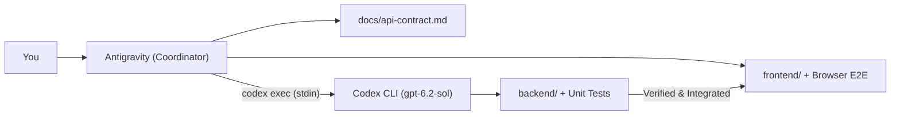

# Codex Orchestrator

An [Antigravity](https://antigravity.google) plugin that pairs **Antigravity** with **OpenAI Codex CLI (`gpt-6.2-sol`)** for full-stack development and cross-model code reviews.

[English](#english) · [简体中文](#简体中文)

---

## English

### How It Works

Instead of letting one agent do everything or manually copy-pasting between apps, **Antigravity** acts as the coordinator while **Codex CLI** handles scoped backend execution in its own process and context window:



| Role | Owner | Responsibilities |
| :--- | :--- | :--- |
| **Coordinator & Frontend** | Antigravity | Architecture, API contract, `frontend/`, backend acceptance, live browser E2E verification |
| **Backend & Review** | Codex CLI (`gpt-6.2-sol`) | `backend/` implementation, backend unit/integration tests, read-only diff reviews |

### Why Use This

- **Contract-first isolation**: Locks `docs/api-contract.md` (or `openapi.yaml`) first and keeps `backend/` and `frontend/` cleanly separated.
- **Lean context window**: Codex runs in its own CLI session and returns concise summaries, keeping Antigravity's context clean.
- **Cross-model second opinion**: Spot blind spots by having Codex review Antigravity's diffs (or vice versa).
- **Zero-hang non-TTY execution**: Pipes prompts via `stdin` (`-`) so `codex exec` never stalls at `Reading additional input from stdin...` in agent shells.

### Quick Start

1. **Install and sign in to OpenAI Codex CLI**:
   ```bash
   npm install -g @openai/codex
   codex
   ```
2. **Install this plugin into Antigravity's global plugins directory**:

   **macOS / Linux:**
   ```bash
   git clone https://github.com/lifuxiaojiedegou/antigravity-codex-orchestrator ~/.gemini/config/plugins/codex-orchestrator
   ```

   **Windows (PowerShell):**
   ```powershell
   git clone https://github.com/lifuxiaojiedegou/antigravity-codex-orchestrator "$env:USERPROFILE\.gemini\config\plugins\codex-orchestrator"
   ```
3. **Start a conversation in Antigravity** (toggle **Codex Orchestrator** anytime on the Customizations / Plugins page).

*(Optional)* Verify non-interactive CLI execution works:

```powershell
# Windows (PowerShell)
"Reply with OK" | codex exec -m gpt-6.2-sol -s read-only --skip-git-repo-check --ephemeral -
```

```bash
# macOS / Linux (bash / zsh)
codex exec -m gpt-6.2-sol -s read-only --skip-git-repo-check --ephemeral - <<'EOF'
Reply with OK
EOF
```

### Example Prompts

- **Start a full-stack project**:
  > Build a task tracker web app. Design the architecture and `docs/api-contract.md` first, delegate `backend/` to Codex CLI (`gpt-6.2-sol`), build `frontend/`, and verify end-to-end.
- **Continue an existing repo**:
  > Inspect this repo read-only first, review `docs/api-contract.md`, and propose how to split the next milestone between Codex (backend) and yourself (frontend + E2E).
- **Second-opinion code review**:
  > Ask Codex (`gpt-6.2-sol`) to run a strict review on my uncommitted changes and summarize any bugs or edge cases.

### Customization

- **Model**: Change `-m gpt-6.2-sol` in `rules/AGENTS.md` and `skills/codex-backend/SKILL.md` (or remove `-m` to inherit `~/.codex/config.toml`).
- **Layout**: Assumes a single repo root with `backend/`, `frontend/`, and `docs/api-contract.md` so `-C <root>` covers both the contract and backend cleanly.

---

## 简体中文

### 这是什么

这是一个给 **Antigravity** 使用的插件：由 **Antigravity** 负责整体架构、接口契约、前端开发与真实浏览器联调，同时在需要写后端或做代码审查时，自动通过命令行调度本机的 **OpenAI Codex CLI (`gpt-6.2-sol`)** 来完成。

### 分工方式

| 角色 | 负责方 | 具体职责 |
| :--- | :--- | :--- |
| **总协调 + 前端 + 联调** | Antigravity | 需求拆解、维护 `docs/api-contract.md` 接口契约、验收后端代码、开发 `frontend/`、启动服务做端到端验证 |
| **后端开发 + 代码审查** | Codex CLI (`gpt-6.2-sol`) | 严格按契约实现 `backend/` 业务代码、编写并运行后端测试、对未提交改动做只读代码审查 |

### 核心优势

- **契约先行，不打架**：先定好接口文档并划清 `backend/` 与 `frontend/` 目录边界，避免前后端字段对不上或互相覆盖文件。
- **不占主对话上下文**：Codex 在独立进程和独立上下文里读代码、改后端、跑测试，Antigravity 主窗口只接收精炼结果。
- **异构模型交叉查漏**：用不同家族的模型互相做 Code Review，更容易发现边界 Bug 和遗漏。
- **内置防卡死写法**：统一通过标准输入管道（`-`）给 `codex exec` 传参，解决终端工具调用时卡在 `Reading additional input from stdin...` 的问题。

### 三步快速开始

1. **安装并登录 OpenAI Codex CLI**：
   ```bash
   npm install -g @openai/codex
   codex
   ```
   *(按提示完成 ChatGPT 或 API Key 登录；如果你平时就在用 Codex 桌面端，通常会自动复用本地登录态。)*

2. **将插件克隆到 Antigravity 全局插件目录**：

   **Windows (PowerShell)：**
   ```powershell
   git clone https://github.com/lifuxiaojiedegou/antigravity-codex-orchestrator "$env:USERPROFILE\.gemini\config\plugins\codex-orchestrator"
   ```

   **macOS / Linux：**
   ```bash
   git clone https://github.com/lifuxiaojiedegou/antigravity-codex-orchestrator ~/.gemini/config/plugins/codex-orchestrator
   ```

3. **在 Antigravity 中直接开聊即可**（可在 Antigravity 的插件管理页随时开启或关闭 **Codex Orchestrator**）。

### 常用说法示例

- **从零做全栈项目**：
  > 帮我新建一个待办管理 Web 应用，先定好架构和 `docs/api-contract.md`，后端交给 Codex CLI（`gpt-6.2-sol`）实现并跑完单测，你负责前端和最终联调。
- **接手已有仓库**：
  > 先只读检查当前仓库和接口文档，列出下一阶段适合派给 Codex 做后端、以及由你做前端和联调的分工方案。
- **独立代码审查**：
  > 让 Codex（`gpt-6.2-sol`）对当前未提交的改动做一次严格的代码审查，汇总潜在 Bug 和边界问题。

### 自定义说明

- **切换 Codex 模型**：修改 `rules/AGENTS.md` 和 `skills/codex-backend/SKILL.md` 中的 `-m gpt-6.2-sol`（或直接删掉 `-m` 参数，改用你本机 `~/.codex/config.toml` 的默认模型）。
- **推荐目录结构**：尽量把前后端放在同一个仓库根目录（`backend/` + `frontend/` + `docs/api-contract.md`），这样一条 `-C <根目录>` 就能让 Codex 读契约、改后端。

---

## Repository Structure / 仓库结构

```text
codex-orchestrator/
├── plugin.json                        # Antigravity plugin manifest
├── rules/
│   └── AGENTS.md                      # Lightweight trigger & CLI stdin rule
├── skills/
│   └── codex-backend/
│       └── SKILL.md                   # Full-stack orchestration & review runbook
├── LICENSE
└── README.md
```

## License

[MIT](./LICENSE)
